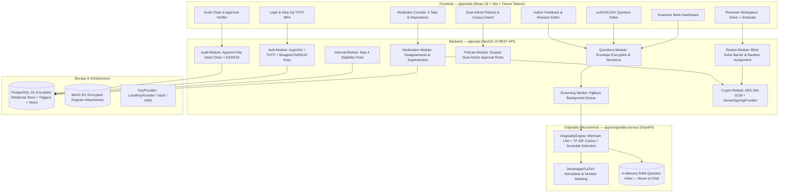
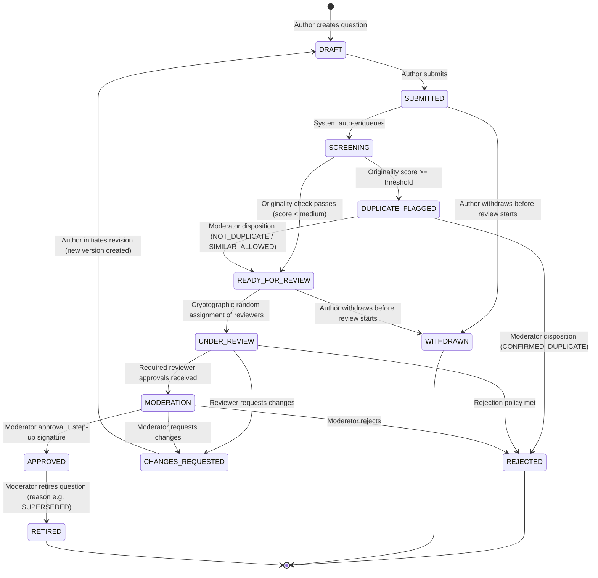
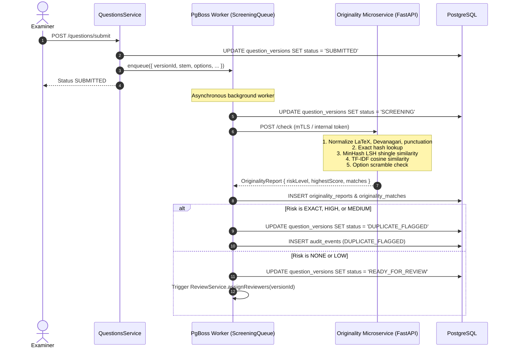
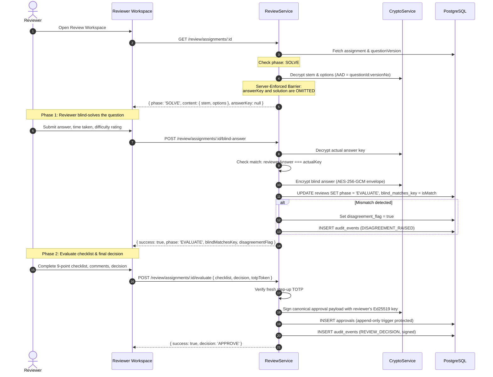

# ExamVault Architecture Document

## 1. System Overview

ExamVault is a secure examination paper generation framework prototype. Step 1 (Examiner Portal and Question Bank) and Step 2 (Review, Originality Check, and Approval Workflow) are fully implemented.

---

## 2. Question Version State Machine

All transitions are strictly enforced in both NestJS application services and PostgreSQL triggers (`trg_question_versions_state_machine` + `question_state_transitions` table). Direct SQL attempts or unauthorized API calls attempting illegal jumps are aborted immediately.

### Transition Matrix Summary

| Current State | Target State | Trigger / Actor | Condition / Guard |
|---------------|--------------|-----------------|-------------------|
| `DRAFT` | `SUBMITTED` | Author | Content and answer key encrypted; commitment saved |
| `SUBMITTED` | `SCREENING` | System | Auto-enqueued to PgBoss job queue |
| `SCREENING` | `READY_FOR_REVIEW` | System | Originality risk level NONE or LOW |
| `SCREENING` | `DUPLICATE_FLAGGED` | System | Originality risk level MEDIUM, HIGH, or EXACT |
| `DUPLICATE_FLAGGED` | `READY_FOR_REVIEW` | Moderator | Written justification stored encrypted; author cannot moderate |
| `DUPLICATE_FLAGGED` | `REJECTED` | Moderator | Written justification; marked `CONFIRMED_DUPLICATE` |
| `READY_FOR_REVIEW` | `UNDER_REVIEW` | System | Required reviewers assigned via Node crypto RNG respecting COIs |
| `UNDER_REVIEW` | `CHANGES_REQUESTED` | Reviewer | Reviewer decision `REQUEST_CHANGES` with encrypted comments |
| `UNDER_REVIEW` | `REJECTED` | Reviewer | Policy-defined rejection rule |
| `UNDER_REVIEW` | `MODERATION` | System | All required reviewer approvals present; no unresolved disagreements |
| `MODERATION` | `APPROVED` | Moderator | Step-up TOTP MFA + Ed25519 signature; atomic parent supersession |
| `MODERATION` | `CHANGES_REQUESTED` | Moderator | Returns feedback to author; new revision needed |
| `MODERATION` | `REJECTED` | Moderator | Rejection with signed rationale |
| `CHANGES_REQUESTED` | `DRAFT` | Author | Creates new version (`v = currentVersion + 1`); parent preserved |
| `APPROVED` | `RETIRED` | Moderator | Mandatory retirement reason (`SUPERSEDED`, `OUTDATED`, `FLAWED`) |
| `SUBMITTED` / `READY_FOR_REVIEW` | `WITHDRAWN` | Author | Permitted only before reviewers start blind solving |

---

## 3. Screening & Originality Verification Sequence

The originality microservice is isolated in a Docker bridge network with `internal: true` (zero outbound internet routing).

---

## 4. Two-Step Blind Peer Review Sequence

The blind solve barrier is strictly enforced on the server. The answer key and author solution are never decrypted or returned to the reviewer until the blind answer has been persisted.

---

## 5. Architectural Choices & Justifications

### 5.1 Why PgBoss for Job Queueing?
- **Zero Additional Infrastructure**: PgBoss runs on PostgreSQL using `SKIP LOCKED` queries, avoiding Redis, RabbitMQ, or additional network attack surfaces.
- **Transactional Enqueue Semantics**: Question state transitions and screening job enqueues share the same database instance, preventing phantom jobs.
- **Failure Resilience**: If the originality service is offline, jobs retry with exponential backoff; questions remain safely in `SCREENING` without slipping through to review.

### 5.2 Why Memory-Only Index for the Question Bank?
- Unreleased examination questions must never be written to plaintext disk caches or unencrypted search engines.
- The in-memory index is populated at startup via an authenticated streaming feed from the main API and rebuilt in RAM.

### 5.3 Server-Enforced Blind Barrier
- Many web applications attempt to hide answer keys by hiding UI elements. ExamVault enforces the barrier in `ReviewService.getAssignmentWorkspace`: the decryption of `encrypted_answer` is not even invoked while `review.phase === 'SOLVE'`.
