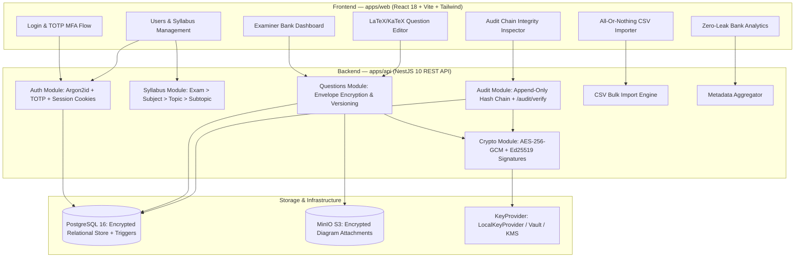
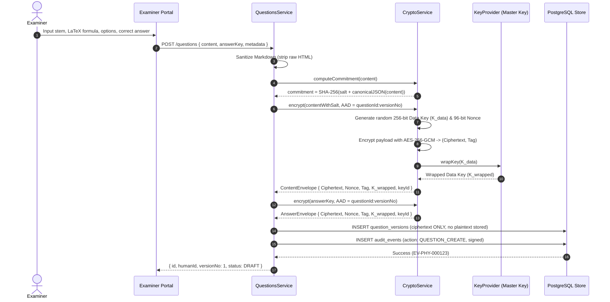

# ExamVault Architecture Document

## 1. System Overview

ExamVault is a research prototype implementing Step 1 (Examiner Portal and Question Bank) of an end-to-end secure examination generation framework.



---

## 2. Encryption & Decryption Data Flow



---

## 3. Tamper-Evident Audit Chain Flow

```mermaid
sequenceDiagram
    autonumber
    actor Actor as Examiner / Admin / System
    participant API as AuditService
    participant DB as PostgreSQL (audit_events)
    participant Crypto as CryptoService

    Note over API,DB: Logged on logins, MFA, questions, content reads, failures
    API->>DB: SELECT entry_hash FROM audit_events ORDER BY timestamp DESC LIMIT 1
    DB-->>API: prev_hash (or GENESIS if first entry)
    API->>Crypto: entryHash = SHA-256(prev_hash + canonicalJSON(event))
    API->>Crypto: signature = Ed25519.sign(entryHash)
    API->>DB: INSERT INTO audit_events (prev_hash, entry_hash, signature, metadata)
    Note over DB: Postgres Trigger: block_audit_events_mutation<br/>Blocks any UPDATE or DELETE queries

    Note over Actor,DB: Chain Verification: GET /audit/verify
    Actor->>API: GET /audit/verify
    API->>DB: SELECT * FROM audit_events ORDER BY timestamp ASC
    loop For each event in chain
        API->>Crypto: Recompute SHA-256(prev_hash + canonicalJSON)
        API->>Crypto: Verify Ed25519 signature
        alt Hash or Signature mismatch
            API-->>Actor: { valid: false, firstBrokenEntry: { id, index, expected, actual } }
        end
    end
    API-->>Actor: { valid: true, totalEntries: N, verifiedEntries: N }
```

---

## 4. Extension Points for Future Steps

This codebase strictly implements Step 1 while providing clean interfaces for subsequent phases:

1. **Review Workflow (Step 2)**:
   - Question statuses `UNDER_REVIEW`, `APPROVED`, `REJECTED`, `RETIRED` are declared in `QuestionStatusEnum`.
   - `REVIEWER` role exists in auth with CASL permission stubs.
2. **Paper Generation (Step 3)**:
   - Audit action `PAPER_GENERATE` is declared in enum.
   - Bank statistics queries provide blueprint for blueprint-based stratified random selection.
3. **Threshold Key Release (Step 4)**:
   - `KeyProvider` interface allows swapping `LocalKeyProvider` with a Shamir's Secret Sharing (m-of-n) or threshold decryption engine.
4. **Blockchain Audit Anchor (Step 5)**:
   - The head `entry_hash` of the audit log can be periodically anchored into an Ethereum or Hyperledger block.
