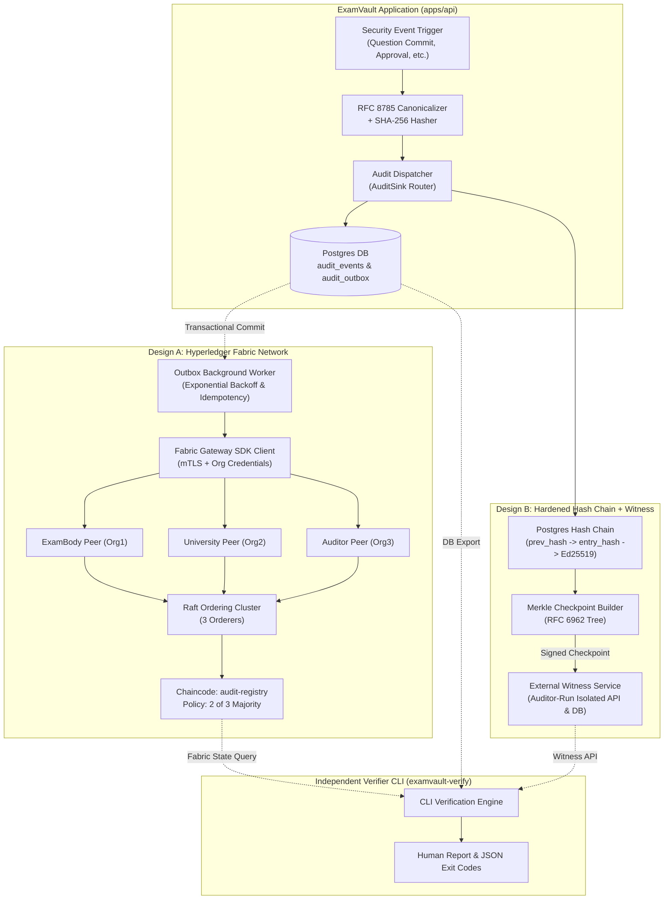

# ExamVault Step 3 Architecture & Specification: Tamper-Evident Audit Layer

## 1. Overview & High-Level Plan

ExamVault Step 3 implements dual-design cryptographic anchoring for every security-relevant event:
- **Design A**: Permissioned Distributed Ledger on Hyperledger Fabric 2.5 LTS across 3 distinct organizations (**ExamBody**, **University**, **Auditor**) with 2-of-3 majority endorsement.
- **Design B**: Hardened cryptographic hash-chain with Ed25519 digital signatures, RFC 6962 Merkle tree batching/checkpoints, and an independent **External Witness Service**.
- **AuditSink Abstraction**: Unified interface allowing the application to emit a single canonical event that fans out to enabled sinks (Design A, Design B, and Baseline PlainLog).
- **Storage Integrity Verification**: SHA-256 ciphertext integrity verification across PostgreSQL and MinIO without content decryption.
- **Independent Verifier CLI**: Standalone tool (`examvault-verify`) that validates integrity from read-only exports without importing business logic.
- **Empirical Experiments**: 9-scenario tamper matrix, performance load benchmarks, failure injection, and operational complexity analysis.



---

## 2. Canonical Event Schema

Every event emitted in ExamVault conforms to the versioned canonical schema:

```typescript
export type EventClass = 'CRITICAL' | 'BULK';

export type EventType =
  // Critical (anchored individually)
  | 'QUESTION_VERSION_COMMITTED'
  | 'APPROVAL_SIGNED'
  | 'VERSION_RETIRED'
  | 'VERSION_SUPERSEDED'
  | 'POLICY_APPROVED'
  | 'USER_ROLE_CHANGED'
  // Reserved for Steps 4-6
  | 'PAPER_GENERATED'
  | 'PAPER_HASH_COMMITTED'
  | 'KEY_SHARE_SUBMITTED'
  | 'PAPER_RELEASED'
  // Bulk (batched into Merkle checkpoints)
  | 'CONTENT_READ'
  | 'USER_LOGIN'
  | 'USER_FAILED_LOGIN'
  | 'MFA_STEPUP_VERIFIED'
  | 'STORAGE_SCAN_COMPLETED';

export interface CanonicalAuditEvent {
  schema_version: '1.0.0';
  event_id: string; // UUID v4
  event_type: EventType;
  timestamp: string; // ISO 8601 UTC with milliseconds (e.g. 2026-10-28T12:00:00.000Z)
  actor_pseudonym: string | null; // HMAC-SHA-256(userId, secret_key) hex string, or null for system
  subject_type: 'QUESTION_VERSION' | 'APPROVAL' | 'POLICY' | 'USER' | 'CHECKPOINT' | 'STORAGE_OBJECT';
  subject_id: string;
  version_no: number | null;
  payload_hash: string; // SHA-256 hex string of canonical event payload
  content_commitment: string | null; // SHA-256 hex string if associated with question/content
  approval_signature: string | null; // Base64 Ed25519 signature if associated with an approval
  prev_event_hash: string | null; // Hex SHA-256 of preceding event (for Design B chaining)
  metadata_hash: string; // SHA-256 hex string of canonical metadata JSON
}
```

### Deterministic Canonicalization & Hashing Rules
1. Serialize the data object using RFC 8785 JSON Canonicalization Scheme (JCS).
2. Compute `SHA-256` digest over UTF-8 bytes of canonical representation:
   $$\text{EventHash} = \text{SHA-256}(\text{JCS}(\text{CanonicalAuditEvent}))$$
3. Test vectors in shared package verify equivalence across Node.js runtime, Fabric chaincode, and independent verifier.

---

## 3. Network Topology (Hyperledger Fabric 2.5 LTS)

```mermaid
graph TB
    subgraph OrdererOrganization["OrdererOrg (OrdererMSP)"]
        Orderer1["orderer1.orderer.examvault.local:7050<br/>(Raft Consensus)"]
        Orderer2["orderer2.orderer.examvault.local:7053"]
        Orderer3["orderer3.orderer.examvault.local:7056"]
    end

    subgraph ExamBodyOrganization["ExamBody (ExamBodyMSP)"]
        CA1["ca.exambody:7054"]
        Peer1["peer0.exambody.examvault.local:7051<br/>Anchor Peer + State DB"]
        ClientApp["ExamVault API Service<br/>(Identity: exambody-admin/app)"]
    end

    subgraph UniversityOrganization["University (UniversityMSP)"]
        CA2["ca.university:8054"]
        Peer2["peer0.university.examvault.local:8051<br/>Anchor Peer + State DB"]
        UnivClient["University Node / Gateway"]
    end

    subgraph AuditorOrganization["Auditor (AuditorMSP)"]
        CA3["ca.auditor:9054"]
        Peer3["peer0.auditor.examvault.local:9051<br/>Anchor Peer + State DB"]
        AuditorNode["Independent Verifier CLI / Witness"]
    end

    Channel["Channel: examvault"]

    Peer1 --- Channel
    Peer2 --- Channel
    Peer3 --- Channel
    Orderer1 --- Channel
    Orderer2 --- Channel
    Orderer3 --- Channel

    ClientApp -->|Submit Proposal| Peer1
    ClientApp -->|Submit Proposal| Peer2
    ClientApp -->|Submit Proposal| Peer3
    ClientApp -->|Broadcast Transaction| Orderer1
```



### Network Endorsement & Access Control Matrix

| Function | Calling MSP Permitted | Endorsement Required | Description |
| :--- | :--- | :--- | :--- |
| `RegisterEvent` | `ExamBodyMSP` only | 2 of 3 (ExamBody + (Univ \| Auditor)) | Anchors individual CRITICAL event. Idempotent on identical hash. Rejects duplicate event ID with mismatched hash. |
| `RegisterCheckpoint` | `ExamBodyMSP` only | 2 of 3 | Anchors Merkle root of batched BULK events. |
| `AttestCheckpoint` | `UniversityMSP`, `AuditorMSP` | 2 of 3 | Records cryptographic countersignature over a registered checkpoint. |
| `GetEvent` | Any (Read-only query) | Single Peer Query | Retrieves event record and registration receipt. |
| `VerifyEvent` | Any (Read-only query) | Single Peer Query | Compares expected hash with ledger state. |
| `GetHistory` | Any (Read-only query) | Single Peer Query | Returns ledger provenance history for a given subject ID. |
| `ListCheckpoints`| Any (Read-only query) | Single Peer Query | Lists anchored Merkle checkpoint roots and ranges. |

---

## 4. Chaincode Interface (`audit-registry`)

Written in TypeScript (`apps/blockchain/chaincode/audit-registry/src/audit-contract.ts`):

```typescript
export interface LedgerEventRecord {
  eventId: string;
  eventType: string;
  eventHash: string;
  schemaVersion: string;
  timestampClient: string;
  timestampLedger: string;
  actorPseudonym: string | null;
  subjectType: string;
  subjectId: string;
  versionNo: number | null;
  payloadHash: string;
  contentCommitment: string | null;
  approvalSignature: string | null;
  metadataHash: string;
  registeredByMSP: string;
  registeredByCertId: string;
  txId: string;
}

export interface LedgerCheckpointRecord {
  checkpointId: string;
  merkleRoot: string;
  rangeStart: number;
  rangeEnd: number;
  count: number;
  timestampLedger: string;
  registeredByMSP: string;
  attestations: Array<{
    mspId: string;
    certId: string;
    signature: string;
    timestamp: string;
  }>;
}
```

---

## 5. AuditSink Abstraction & Reliability (Outbox Pattern)

```typescript
export interface Receipt {
  sinkType: 'SIGNED_LOG' | 'FABRIC' | 'PLAIN_LOG';
  receiptId: string;
  timestamp: string;
  blockNumber?: number;
  transactionId?: string;
  witnessSignature?: string;
}

export interface VerifyResult {
  valid: boolean;
  sinkType: string;
  checkedAt: string;
  details: Record<string, unknown>;
  discrepancy?: string;
}

export interface AuditSink {
  readonly sinkType: string;
  append(event: CanonicalAuditEvent): Promise<Receipt>;
  verify(eventId: string, expectedHash?: string): Promise<VerifyResult>;
}
```

### Transactional Outbox Flow
1. API handler opens a PostgreSQL transaction.
2. The core business entity (question version, approval, policy) is mutated.
3. The canonical event is inserted into `audit_events` (Design B hash-chain).
4. For each enabled sink requiring async submission (Design A Fabric), an outbox row is inserted into `audit_outbox` with status `PENDING`, retry count `0`, payload JSON, and idempotency key `eventId`.
5. Transaction commits atomically.
6. The background worker picks up `PENDING` outbox rows in timestamp order, submits to Fabric Gateway, updates status to `COMMITTED` with `tx_id` and `block_number`, or applies exponential backoff on failure (`FAILED` after max retries).
7. If Fabric is offline, the API remains 100% operational; events queue in outbox; the UI displays "Anchoring Delayed (N queued)"; on network restoration, the worker flushes the backlog in order.
8. A periodic reconciliation job compares local events against Fabric records and surfaces any discrepancies.

---

## 6. Design B Hardening: Merkle Checkpoints & External Witness

1. **RFC 6962 Merkle Tree Implementation**:
   - Leaf hash: $\text{H}(\text{0x00} \mathbin{\Vert} \text{CanonicalEventBytes})$
   - Node hash: $\text{H}(\text{0x01} \mathbin{\Vert} \text{LeftChild} \mathbin{\Vert} \text{RightChild})$
   - Balanced binary Merkle tree over batches of $N$ events or after timeout $T$.
2. **Inclusion Proofs**:
   - Given event index $i$ in batch, returns audit path $(h_1, h_2, \dots, h_k)$ with left/right direction bits.
   - Verifier hashes leaf with path and checks root equality.
3. **External Witness Service**:
   - Standalone microservice running in an isolated container/process (`apps/witness-service`).
   - Own independent SQLite/PostgreSQL storage and Ed25519 signing key pair.
   - Endpoint `POST /checkpoints`: Receives signed checkpoint from ExamVault API.
   - Verification: Checks ExamBody signature, verifies tree size increases monotonically and is consistent with previous witness checkpoint.
   - Countersigns: Signs the checkpoint and returns an Ed25519 witness receipt.
   - Conflict Detection: If an incoming checkpoint contradicts the stored history (fork attack / rewrite attempt), it raises a `WITNESS_ALERT` and rejects the submission with HTTP 409 Conflict.

---

## 7. Storage Integrity Verification

1. **Ciphertext Hash Binding**:
   - Database column `ciphertext_sha256` added to encrypted entities (`question_versions`, `reviews`, `duplicate_dispositions`).
   - Populated at encryption time as $\text{SHA-256}(\text{encrypted\_content} \mathbin{\Vert} \text{content\_tag})$.
2. **Integrity Scanner Job**:
   - Reads stored encrypted binary buffers from database and MinIO.
   - Computes live SHA-256 digest without decrypting and without accessing the master key.
   - Compares against stored `ciphertext_sha256`.
   - Flags missing objects, corrupted bytes, or orphaned records as audit events.
3. **Threat Boundary**:
   - Detects: Storage medium bit rot, unauthorized database tampering, or direct S3 bucket modification.
   - Does not detect: A compromised key holder legitimately re-encrypting malicious text with valid keys.

---

## 8. Independent Verifier CLI (`examvault-verify`)

A zero-dependency standalone CLI tool:
- Reads exported database JSON / direct read-only SQL connection.
- Verifies:
  1. Design B SHA-256 hash-chain continuity ($\text{EntryHash}_i = \text{SHA-256}(\text{EntryHash}_{i-1} \mathbin{\Vert} \text{Event}_i)$).
  2. Ed25519 signatures on all audit entries.
  3. Merkle inclusion proofs for batched events.
  4. Witness consistency and counter-signatures via Witness API.
  5. Fabric ledger registration: queries Fabric peer gateway using Auditor identity, verifies event hash match and 2-of-3 endorsement validity.
  6. Content commitment binding on approvals.
- Output: Structured terminal summary table, pinpointing exact first broken record, plus machine-readable JSON output and exit code (0 = clean, 1 = integrity failure).
